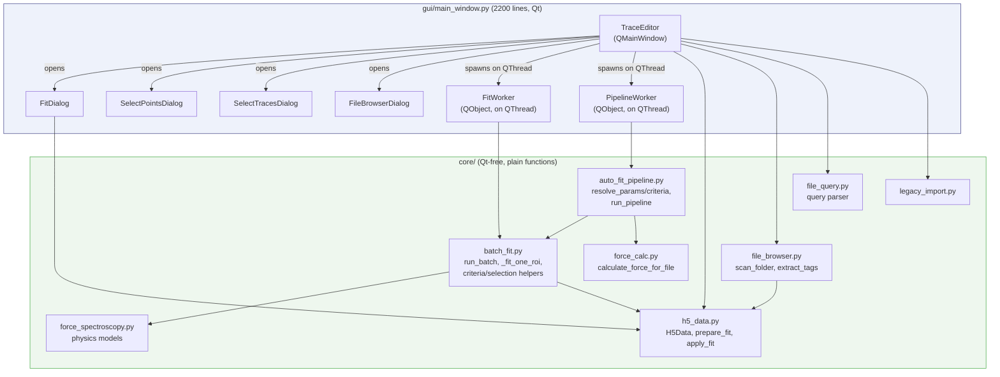
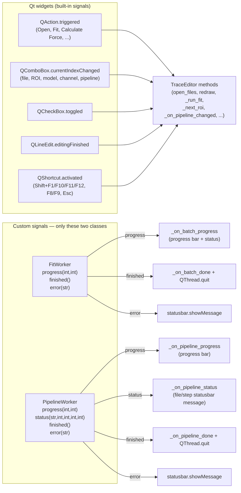
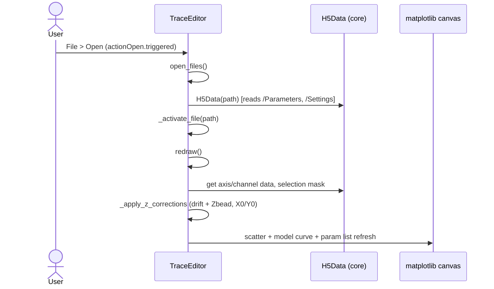
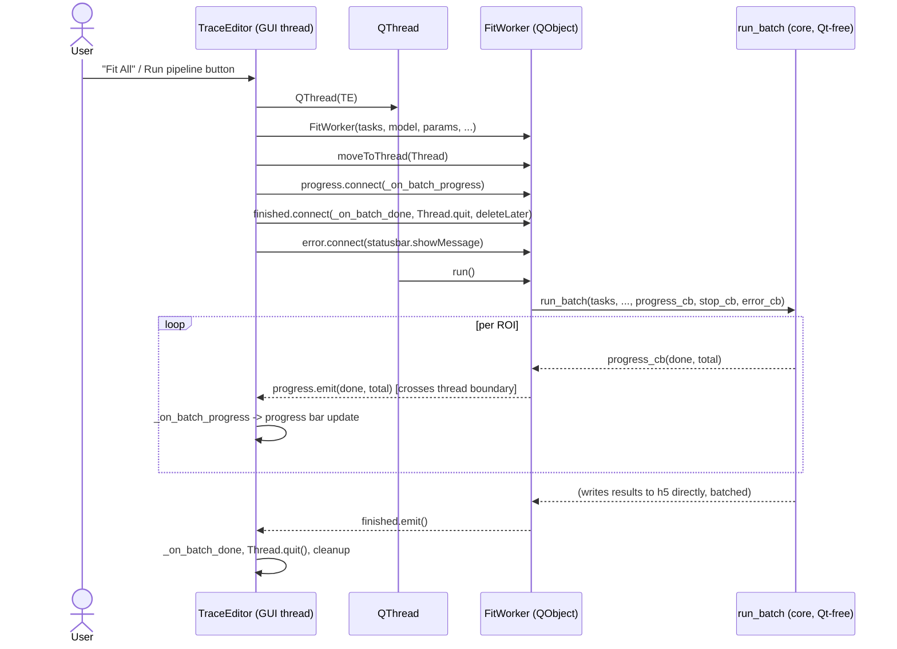

# Architecture

Technical reference for the TraceEditor internals. For design philosophy and
contribution rules see [`../CONTRIBUTING.md`](../CONTRIBUTING.md); for the file
format see [`file-format.md`](file-format.md); for the generated API reference
see [`api/`](api/).

## File layout

```
src/trace_editor/
  __init__.py
  __main__.py              — entry point for `python -m trace_editor`

  gui/
    main_window.py         — all UI logic (TraceEditor class + dialogs)
    main_window.ui         — Qt Designer source. EDIT THIS for layout changes,
                             then regenerate ui_main_window.py:
                               pyside6-uic src/trace_editor/gui/main_window.ui \
                                 -o src/trace_editor/gui/ui_main_window.py
    ui_main_window.py      — AUTO-GENERATED from main_window.ui. DO NOT EDIT.
    themes.toml            — plot colour definitions (light theme only)
    traceeditor.mplstyle   — matplotlib style

  core/
    h5_data.py             — H5Data class + prepare_fit / apply_fit helpers
    legacy_import.py       — import_legacy_hdf(): converts legacy .hdf (PyTables)
                               files to the new .h5 format; see docs/file-format.md
                               for the field mapping
    inspect_h5.py           — open_in_vscode_h5web(): shells out to the `code`
                               CLI to open a file in the H5Web VS Code extension
    force_spectroscopy.py  — physics models (zWLC, MagnetForce, zFiber, etc.)
    batch_fit.py            — batch-fit orchestration: sequential loop or
                               ProcessPoolExecutor pool, picked per model via
                               its :multiprocessing: docstring tag (below).
                               Qt-free — importable/testable with no QApplication.
```

## Component overview



Everything under `core/` is plain Python with no Qt dependency — the
entire Qt signal/slot layer lives in one file, `gui/main_window.py`. That
file has only two classes that define custom `Signal`s (`FitWorker`,
`PipelineWorker`) — both exist purely to bridge a background `QThread`
back to the GUI thread. Every other interaction (menu clicks, combobox
changes, shortcuts) connects a stock Qt widget signal straight to a
`TraceEditor` method, mostly wired in one place: `_connect_signals()`
(`main_window.py:890`).

## Signal/slot map



Widget signals are all 1-hop (widget → one `TraceEditor` method) — there
is no fan-out or chained-signal tangle to worry about. The only multi-hop
chains are the two worker/`QThread` pairs; `FitWorker` is
`progress`/`finished`/`error`, and `PipelineWorker` adds one more —
`status(model_name, step, total_steps, file_index, total_files)`, emitted
once per pipeline step so `_on_pipeline_status` can show which file/step is
currently running (the plain `progress(done, total)` percentage alone
resets at every step/file boundary and can't convey that on its own). If
simplifying anything signal-related, the obvious candidate is
**de-duplicating `FitWorker`/`PipelineWorker`** into one generic `QThread`
adapter parameterized by the callable to run — they are otherwise
structurally identical.

`FitDialog.live_preview_fn` (passed into `FitDialog.__init__`, wired to
`TraceEditor.redraw`) behaves like a signal — it fires on every param
edit and crosses the dialog/window boundary — but it is a plain stored
callback, not a Qt signal. Easy to mistake for one when reading the code.

## Key flows



`redraw()` (`main_window.py:1372`) is the single choke point all display
state flows through — called directly from `_activate_file` and from
every plot-affecting control's signal (no custom signal involved).



This is the one place custom signals genuinely earn their keep: `progress`/
`finished`/`error` are the only safe way to get data back across the
worker-thread boundary. `PipelineWorker` (`main_window.py:753`) is the
same diagram with `run_pipeline` instead of `run_batch`. See "Batch
fitting" below for what happens inside `run_batch` itself, and "Z
correction logic" for the drift/Zbead math applied along the way.

## UI layout (3-column)

```
LEFT                  CENTER                       RIGHT
─────────────────     ──────────────────────────   ──────────────────
Model (combobox)      Filename: [fileComboBox]     ROI: [combobox]
Parameters            matplotlib plot               ROI selected (cb)
(QListWidget)         progressBar                   View only selected (cb)
                                          ── X axis ──
                                          xChannelComboBox
                                          min / max edits (one line)
                                          Log checkbox
                                          ── Y axis ──
                                          yChannelComboBox
                                          min / max edits (one line)
                                          Log checkbox
                                          ── Color ──
                                          colorComboBox
                                          ── Notes ──
                                          notesText (QLabel)
```

## Parameter storage convention

Fit results live as float64 fields on the `/Parameters` compound dataset (see
[file-format.md](file-format.md) for the on-disk layout).

- ` selected` — float: 1.0 = selected (ROI included in batch ops), 0.0 = rejected
- `<param> Error` — fit stderr for that parameter (e.g. `F (pN) Error`); named
  this way so it sorts alphabetically adjacent to its value column in h5 viewers
- `R2 <model>` — R² of last fit for that model, evaluated only on the
  selected/masked points used to fit (e.g. `R2 zWLC`)
- `R2 full <model>` — same R² formula evaluated against the model's
  prediction over the *whole* trace, not just the fit selection; more
  reliable than `R2 <model>` when the selection is small or low-variance
  (e.g. `R2 full zWLC`) — see `core.h5_data.apply_fit`
- `_src_<param>` fields are NOT stored or used — Global/Local/Fit type is
  inferred at runtime from whether a value and error exist

## Module-level fit helpers

Standalone functions, not methods — easy to test independently. See the
[generated API docs](api/main_window.md) for signatures. Point-selection
criteria evaluation (`_evaluate_criteria`, `_apply_point_selection`,
`_get_fit_selection`) lives in `core/batch_fit.py`, not `gui/main_window.py`,
even though it's used heavily from the GUI — `core/batch_fit.py` is imported
by spawned worker processes (see its module docstring) and must stay
Qt-free, so anything `_fit_one_roi` needs at fit time has to live there;
`gui/main_window.py` imports it back for its own (non-worker) call sites.

| Function | Location | Purpose |
|---|---|---|
| `_exponential_drift(time, Z0, dZ_dt, tau)` | `core/batch_fit.py` | Evaluates ExponentialDrift model |
| `_evaluate_criteria(criteria, h5data, roi)` | `core/batch_fit.py` | Pure/read-only criteria evaluation, no h5 writes |
| `_apply_point_selection(criteria, h5data, roi)` | `core/batch_fit.py` | `_evaluate_criteria` + persists mask to `Traces/Selection/<roi>` |
| `_apply_trace_selection(criteria, h5data, roi)` | `gui/main_window.py` | Applies trace-level selection, saves ` selected` |
| `_correct_z_for_fit(y, model_name, names, h5data, roi)` | `core/batch_fit.py` | Subtracts drift+Zbead from Z before fitting |
| `_store_fit_result(p, names, result, model_name, h5data, roi)` | `core/batch_fit.py` | Writes fit result; accumulates z_bead into Zbead |
| `_get_fit_selection(model_name, h5data, roi, mode, active_pipeline)` | `core/batch_fit.py` | See "Selection modes" below |

## Selection modes (Default / Manual)

Each fit pipeline step may define a **default** point-selection criterion
(see "Fit pipelines" below), plus every ROI may have its own **manual**
point-selection mask — the Fit dialog's Default/Manual toggle picks which
one is used for fitting, and the same choice drives what the plot
highlights.

- **Default** — `_get_fit_selection(h5data, roi, mode="default", criteria=...)`
  evaluates the given `criteria` fresh against the current ROI's data via
  `_evaluate_criteria`. `_get_fit_selection` itself (and everything in
  `core/batch_fit.py`) has no notion of "pipeline" — resolving *which*
  criteria apply for a model is the caller's job, via
  `core.auto_fit_pipeline.resolve_criteria` (the active pipeline's own step
  for that model, or no criteria at all if the step doesn't list any — no
  fallback to another pipeline). `FitDialog` resolves this once per dialog
  open (`self._criteria`, mirroring how `self.params` is resolved once via
  `resolve_params`) and passes the plain list down to `_run_fit`/
  `_start_batch`/`FitWorker`; `run_pipeline` resolves it once per step.
  Criteria shape matches `SelectPointsDialog`'s table: `{channel, min, max,
  derivative, invert}`; `min`/`max` may be a plain number or a percentile
  string like `"p90"`, resolved per-trace by `_resolve_bound` (which is why
  it must be re-evaluated per ROI, not resolved once into a shared mask). A
  model with no configured criteria (most models) uses every point.
- **Manual** — reads the ROI's own persisted mask at
  `Traces/Selection/<roi>` (`H5Data.get_selection_mask`), the same mask
  `SelectPointsDialog` and "Select points in view" (`Select > Points > In
  view`, `TraceEditor._select_points_in_view`) write via
  `_apply_point_selection`. Each ROI in a batch run uses its own stored
  mask — there is no separate shared "manual criteria" object.

The mode itself is a single **global/session** flag,
`TraceEditor._selection_mode` (`"default"` | `"manual"`), not persisted
per-ROI — it applies uniformly to the currently-viewed plot's highlight
(`redraw()`), `Fit Current`, and `Fit All`. `FitDialog` shows it as a
`QTabBar` ("Default selection" / "Manual selection") above the params table
— plain checkable `QPushButton`s were tried first but macOS's native style
doesn't render checked-button state reliably (looked indistinguishable from
ordinary focus/default-button styling and didn't visibly move on click);
tab selection has unambiguous, platform-consistent active-state styling.
Switching tabs writes back to `TraceEditor._selection_mode` and calls
`live_preview_fn` (`redraw`) so the highlighted points update immediately,
with no recompute cost beyond re-evaluating criteria/re-reading the mask.
Both `_run_fit` (single-ROI) and `run_batch`/`_fit_one_roi` (batch) take
`selection_mode`/`mode` and thread it straight into `_get_fit_selection`,
so what you see highlighted while previewing is exactly what gets fit.

`_get_fit_selection` returning `None` means "use every point" (no mask
restricts the fit) — `redraw()` highlights every point in that case, not
the whole-trace `' selected'` flag (a separate, unrelated concept: whether
this ROI is included in batch operations at all). Conflating the two used
to make `redraw()` show nothing highlighted for a deselected-but-otherwise-
unrestricted ROI, even though a fit would still use every point.

**"Select points in view"** (`_select_points_in_view`) reintroduces the
legacy `TraceEditor.py` shortcut: instead of typing bounds into
`SelectPointsDialog`, it builds criteria directly from whatever channels
are on the x/y axes and the plot's current view limits (`ax.get_xlim()`/
`get_ylim()`), applies+persists them via `_apply_point_selection` (same as
the dialog), and switches to Manual mode. Unlike the legacy version there
is no separate Ctrl-drag zoom-then-revert dance — box-zoom is already a
normal plot interaction, so the action just reads whatever the view
currently shows.

## Z correction logic (critical)

The displayed Z and the fitting Z are both corrected — this must stay consistent:

**Display** (`_apply_z_corrections` in `redraw`):
- `Z (um)` when model ≠ ExponentialDrift: subtract `_exponential_drift(time, Z0, dZ_dt, tau)` + `Zbead (um)`
- `X/Y (um)`: subtract `X0/Y0 (um)`

**Fitting** (`_correct_z_for_fit`):
- Same subtraction applied to y_data before calling `apply_fit`
- This means fitted `z_bead` is a residual, not absolute — so `_store_fit_result` **accumulates** it: `stored_Zbead += fitted_z_bead`
- Both functions take an optional `zbead_baseline` override so callers can pin
  the accumulation point instead of re-reading whatever is currently in h5
  (see live preview below for why that matters)

**Model curve** (`_draw_model_curve`):
- `z_bead` param forced to 0 before model evaluation
- Model output plotted directly (no correction) — aligns with corrected data because zbead=0

This matches the original `TraceEditor.py` lines 474-516 exactly.

## Fit dialog (`FitDialog`)

Opened from menu Fit (Shift+F1 shortcut). Shows all model parameters with:
- **Type** combo: `Global` / `Local` / `Fit` (used only inside the dialog to control vary; not stored)
- **Value** edit (editable)
- **Error** display (read-only, shown when type=Fit)

Buttons: Cancel / Fit Current (fit current ROI) / Fit All (fit all selected ROIs).
Cancel, or closing the dialog via the window's close button, reverts any
live-preview writes made while the dialog was open, restoring the H5
parameters for this ROI to their pre-dialog state (removing any parameter
that didn't exist before). **Fit All** is the dialog's default button
(`setDefault(True)`, `Cancel`/`Fit Current` have `setAutoDefault(False)`) —
without this, Qt auto-assigns default-button styling to whichever button
was added first (`Cancel`), which on macOS renders as an accent-colored
"primary action" look that's misleading for a destructive/no-op button.

The dialog sizes itself to show every parameter row with no scrolling: the
params table's height is capped at its real content height
(`resizeRowsToContents()` + summed row heights + header), and the dialog
calls `adjustSize()` (with `setMinimumWidth(600)` so it doesn't collapse
narrower) rather than a hand-computed pixel height — `QTableWidget`
defaults to an expanding size policy, so without capping its height the
enclosing layout has nothing correct to report and clips the last row(s).
A model with many parameters (e.g. `zFiber`, 18 rows) gets a taller dialog
automatically; a small model (e.g. `ExponentialDrift`, 3 rows) gets a short
one — no scrollbar either way.

Seeding logic on open:
- No stored value → `Global`
- Stored with `_err_ > 0` → `Fit`, vary=True
- Stored without error → `Local`, vary=False

Live preview: changing any value/type immediately reruns the fit and calls `redraw()`.

**Zbead accumulation during live preview**: `_correct_z_for_fit`/`_store_fit_result`
normally read+accumulate `Zbead (um)` straight from h5, which only works if
that slot isn't touched between reads. Live preview can run many times per
dialog session (once per edit), so `FitDialog` freezes `self._zbead_baseline`
from the pre-dialog snapshot at `__init__` and passes it into every preview
call, and skips writing the live z_bead value into h5 (the model curve
already forces z_bead to 0, so this only holds the *display* shift steady
until commit). Without this, editing z_bead's value field while it stays
`Type=Fit` would write the typed guess into h5, get read back as the
"baseline" on the next preview fit, and compound with each edit — the bug
this fixes. Committing via Fit Current/Fit All uses the real stored baseline
as usual (no override passed), so the accumulation only actually advances
once the user commits.

## Left panel params list

Shows all stored parameters alphabetically. Each param gets a value row. If an
error is stored (`_err_<label> > 0`), an additional `"<label> Error"` row is
shown, sorted alphabetically alongside the value row. No type tag is displayed.

## Batch fitting (`FitWorker` / `core.batch_fit`)

`FitWorker` is a `QThread` + `QObject` adapter — it owns no fitting logic
itself. It delegates the actual work to `core.batch_fit.run_batch`, which is
Qt-free (importable and testable with no `QApplication`) and does everything
below. Progress bar shown during run. Esc stops it (`FitWorker.stop_requested`
→ `run_batch`'s `stop_cb`).

For each ROI, `_fit_one_roi` (run either sequentially or inside a worker
process — see below):
1. Opens its own `H5Data(filepath)` — no in-memory cache to share, so this
   is cheap and lets each ROI's fit be fully independent
2. Deep-copies params (so global values are consistent across all ROIs)
3. Seeds non-varying *Local* params from stored h5 values (Global params keep
   the dialog's fixed value for every ROI)
4. Calls `_correct_z_for_fit` on y data
5. Calls `apply_fit`
6. Returns the fitted values (does **not** write to disk itself)

`run_batch` then writes all results back to their h5 files in the caller's
process, accumulating Zbead the same way `_store_fit_result` always has, plus
`R2 <model_name>` for later trace selection. Writes are batched one
open/read/write cycle per file (`H5Data.set_parameters_bulk`), not one call
per ROI per field — `set_parameter` rewrites the entire `/Parameters` array
on every call, so writing N ROIs one field at a time is O(N²) I/O; batching
makes it O(N). This mattered in practice: it was an ~8s bottleneck at 300
ROIs, dwarfing both the fitting itself and the multiprocessing this exists to
add.

### Sequential vs. multiprocessing

`run_batch` can fit ROIs either in a plain sequential loop (in-process) or in
parallel across a `concurrent.futures.ProcessPoolExecutor`. **Threads were
not an option here**: the fit models are pure-Python functions making many
small numpy calls rather than one big vectorized op, and `lmfit`/`scipy`'s
optimizer driver is itself pure Python — most of a fit's wall time is spent
holding the GIL, so threads would mostly serialize on it. Separate processes
have separate interpreters/GILs and give real parallelism for this workload.

That said, **multiprocessing is not free** — spawning worker processes and
re-importing this module in each one costs roughly **1 second per worker**
(paid once per batch run, not per ROI), plus a small per-task IPC/pickling
cost. For cheap models that fixed cost dominates and the pool is *slower*
than sequential — sometimes 5–10x slower. For expensive models, the pool
wins big (3–8x faster, measured). So pooling is **opt-in per model**, not
always-on.

**A model opts in with a `:multiprocessing: true` line in its
`force_spectroscopy.py` docstring**, e.g.:

```python
def zHMf2(x, ...):
    """
    ...
    :return: Z (um) # extension of the fiber
    :multiprocessing: true # calls zHMf 4x per eval; batch fits benefit from a process pool
    """
```

`core.batch_fit.model_wants_multiprocessing(model_name)` reads this by exact
line match (`line.strip().startswith(":multiprocessing:")`) — deliberately
*not* the substring/`str.split` approach `prepare_fit` uses for `:param:`
ranges, so the tag can never be mistaken for part of a `:param <name>:` line
or corrupt a parameter's `[min, max]` range regardless of what any parameter
is named. `run_batch(..., use_pool=True/False)` overrides the tag for a
one-off call if needed; the default (`use_pool=None`) auto-detects.

**Rule of thumb for tagging a model**: benchmark a single fit
(`scripts/benchmark_batch_fit.py`, or just time `apply_fit` once) at your
real data's point count and free-parameter count.

| Single fit takes | Tag it? |
|---|---|
| < ~0.5 s | No — pool overhead (≈1s/worker spawn + import) will make batches *slower* |
| ~0.5 s – a few s | Marginal — depends on batch size; only worth it if batches are consistently 200+ ROIs |
| a few s or more | Yes — pool wins decisively, often 3–8x, larger for bigger batches |

Currently tagged: `zHMf`, `zHMf2` (both loop or call sub-models multiple
times per evaluation — `zHMf2` calls `zHMf` four times for bilinear
interpolation over non-integer `n_dimer`/`n_gap`). Everything else
(`zWLC`, `zFiber`, `ExponentialDrift`, etc.) evaluates in well under a
millisecond and is deliberately left untagged.

## Selection dialogs

### SelectPointsDialog (Select > Points > By Criteria)
- Table: all channels × min / max / derivative / invert
- Live preview: updates plot as you type, coloring selected points vs grey
- Batch button: applies criteria to all selected ROIs
- Z (um) is drift+Zbead corrected before thresholding (matching original)
- The resulting per-point mask is persisted to `Traces/Selection/<roi>` (see
  `docs/file-format.md`) and is what `_get_fit_selection` uses in **Manual**
  selection mode (see "Selection modes" above) — not automatically for every
  model, since each model's **Default** criteria (if any) take precedence
  unless the Fit dialog's toggle is switched to Manual.
- `Select > Points > In view` (`_select_points_in_view`) is an alternate way
  to build the same kind of criteria, without opening this dialog: channel
  and min/max come from the current x/y axes and view limits instead of
  typed values.

### SelectTracesDialog (Select > Traces > Criteria)
- Table: all stored parameters × min / max / invert
- OK applies to all selected ROIs, updates ` selected` field
- Use `R2 zWLC` min=0.9 to keep only well-fitting WLC traces

## Open File browser (`FileBrowserDialog`)

File > Open scans one folder's `.h5` files into a sortable/queryable table
before opening anything, so files can be triaged without opening each one —
useful when a batch run produces many files but only a few are relevant.

- `core/file_browser.py`'s `scan_folder()` / `scan_h5_metadata()` read only
  root attributes, `/Settings`, and the small `/Parameters` array per file
  (via `H5Data` getters: `get_axis()`, `get_notes()`, `get_date()`,
  `get_user()`, `num_rois()`, `selected_count()`, `get_lut_filename()`) — no
  trace data is loaded, so scanning dozens of files is fast. A file that
  errors on read (e.g. missing `num_rois`) shows as a row with its error
  message in place of Notes, rather than aborting the scan.
- Columns: Filename, Axis, Tags, Selected/Total, LUT, Notes, Date. All rows
  are always shown — `axis` (`Shift_mm` / `Focus_mm`) is just which motor
  was moved during the experiment, not a LUT-file marker (actual `.LUT`
  calibration files use a separate extension/format and never appear in
  this `.h5` browser), so there is no hide/show filter on it.
- **LUT** is the calibration file used to compute bead height for this
  experiment, from `/Settings` (`Imaging`/`lut_filename`), shown as a bare
  filename with no path or extension (e.g. `data_013`). Blank if
  `/Settings` is absent (e.g. legacy-imported files).
- **Tags** come from `extract_tags()` in `core/file_browser.py`: any
  `#word` token found anywhere in Notes becomes a tag (case-insensitive,
  deduplicated, in order of first appearance) — a free-form vocabulary, not
  a fixed keyword list, so a new tag needs no code change. E.g.
  `"Fail — #lowdensity #retry"` yields tags `lowdensity`, `retry`.
- **Notes** stretches to fill remaining column width, with a tooltip
  showing the full text (`QStandardItem.setToolTip`) since the display text
  elides when it doesn't fit.
- **Query box** (`core/file_query.py`) replaces a plain substring search so
  that e.g. searching for `shift` doesn't also match `Focus_mm` rows whose
  Notes happen to contain the word "shift". Small hand-written
  tokenizer/recursive-descent parser (no `eval` of arbitrary Python, so
  query text can never execute code) supporting:
  - Fields: `axis`, `tag`, `notes`, `filename`, `selected`, `total`
    (alias `num_rois`), `lut` (alias `lut_filename`), `user`, `date`.
  - Operators: `=`/`==` (substring match for strings, exact for numbers),
    `!=`, `>`, `<`, `>=`, `<=`; boolean `and`/`or`/`not`; parentheses.
  - Example: `axis = shift and not tag = fail and selected >= 10`.
  - Case-insensitive throughout (keywords, field names, and string
    comparisons); no quoting needed around values.
  - A malformed query just tints the query box red (`QueryError` caught in
    `_on_query_changed`) and leaves the current filter in place, rather
    than crashing.
  - Row visibility is set directly via `QTableView.setRowHidden()` (mapped
    proxy→view row), not via `QSortFilterProxyModel`'s own filter
    mechanism, since the query needs access to the raw `scan_folder()` row
    dicts (numeric `num_rois`/`selected`, the `tags` list) rather than only
    the display strings the model holds.
- Sorting is the stock `QSortFilterProxyModel` column-header sort — no
  custom code. Note that `QTableView`'s `setSortingEnabled(True)` applies
  an initial sort as soon as the model attaches, so proxy (view) row order
  can differ from source-model row order even before any header is
  clicked — code operating on selections must resolve rows through
  `proxy.mapToSource()`, never assume view row == source row.
- One folder at a time — switching folders re-scans; there is no
  persistent multi-folder bookmark list (kept deliberately simple).
- Double-click a row, or select rows (multi-select supported) and press
  Open, to return the chosen paths — same shape as the old
  `QFileDialog.getOpenFileNames` return value, so `open_files()`'s
  downstream loading logic is unchanged.
- Editing Notes happens in the **main window**, not this dialog — see
  "File metadata panel" below.
- Matching the same physical bead across separate files by ROI X/Y
  position (e.g. to propagate a selection when the same beads are reused
  across a shift experiment and a follow-up rotation experiment) is a
  known desired feature, not yet implemented.

## Fit pipelines (`core.auto_fit_pipeline`)

A **pipeline** is a named, ordered sequence of fit steps declared entirely in
`app_config.toml`, replacing the old flat `[model_defaults]`/`[[model_selection]]`
sections as the single source of truth for both interactive and automatic
fitting. See `app_config.default.toml` for the full schema/example
(`zwlc_pipeline`: fit `ExponentialDrift`, calculate Force, fit `zWLC`).

- A pipeline is a top-level TOML array-of-tables; each element is one step —
  either a `ForceSpectroscopy` model name (run via `run_batch`) or the
  literal `"calculate_force"` — executed strictly in file order. Each step
  optionally lists per-parameter `params` (`{vary, value, min, max}`, any
  subset) and `criteria` (same shape as the old `[[model_selection]]`, now
  scoped per-step instead of globally per-model).
- `core/auto_fit_pipeline.py` (Qt-free) provides `resolve_params`/
  `resolve_param_sources`/`resolve_criteria`/`resolve_force_defaults`: for any
  model, only the active pipeline's own matching step is consulted (falling
  back to the model's bare docstring default via `prepare_fit` if the step
  doesn't set a given param, or to no criteria/`[force_defaults]` if it
  doesn't list any) — there is no fallback to another pipeline. Pipelines are
  fully explicit; `default_pipeline` is not special beyond being the pipeline
  selected by default the first time the app runs. `find_step_for_model`
  (used by all of the above) returns the *first* step matching a given model
  name, so a pipeline that lists the same model more than once only exposes
  the first occurrence's params/criteria to the interactive Fit dialog —
  `run_pipeline` itself still runs every occurrence correctly, in order.
- `resolve_force_defaults(active_pipeline, config)` is shared by the
  interactive "Calculate Force" action and `run_pipeline`'s `"calculate_force"`
  step, so both compute the same calibration constants from the same config.
- `run_pipeline(pipeline_name, filepath, config)` runs every step against one
  file: `"calculate_force"` calls `core/force_calc.py`'s
  `calculate_force_for_file` directly; fit-model steps call `run_batch` over
  every ROI. `run_batch` writes results to disk before the next step runs, so
  a later step (e.g. `zWLC`) can assume an earlier step's output (e.g.
  `F (pN)`) is already persisted.

### `FitDialog`'s Global / Local / Fit types

These three types describe *where* a parameter's dialog value comes from —
not whether it varies, and not inferred from stored fit history:

- **Fit**: the active/default pipeline sets `vary = true` for this parameter.
  Source is lmfit; the checkbox starts checked, seeded from the pipeline's
  initial value if it also sets one.
- **Global**: the pipeline sets a fixed `value` (no `vary`) for this
  parameter. Source is the pipeline config, shared across every trace —
  editing it in the dialog is session-only and is never written to this
  ROI's stored parameters (only `_run_fit`/`run_batch`'s commit path writes
  fit results, and it writes every param in the result including fixed
  ones — see `_store_fit_result` — but a Global param's *value* only ever
  changes by editing the pipeline itself, not by fitting).
- **Local**: the pipeline doesn't mention this parameter at all. Source is
  this ROI's own stored h5 value (from any prior fit, by any model — e.g.
  `Zbead (um)` fit once by `zWLC` and reused by a later `zFiber` fit),
  falling back to the model's bare default only if nothing is stored yet.

`resolve_param_sources` computes this classification once per model/pipeline;
`FitDialog.__init__` uses it directly instead of inspecting stored values or
errors to guess a type.

## In-app folder watcher + auto-fit-on-open

Folder-watching and auto-fitting newly-opened files both live inside
`TraceEditor` itself (no external process/IPC):

- **File > Watch Folder…** picks a folder (persisted via `QSettings`,
  `watch_folder`/`watch_enabled`) and starts a `QTimer`-driven poll
  (`_check_watched_folder`, ~1.5s interval) for new `.h5` files. A candidate
  is opened once its `(size, mtime)` is unchanged across two consecutive
  polls and it opens via a quick `h5py.File(path, "r")` probe (the tweezer
  software has finished writing and closed it). Files already present when
  watching starts are seeded as known, not auto-opened. **File > Watching**
  is a checkable toggle to pause/resume without forgetting the folder.
- **Parameters > Auto-fit on File Open** (`actionAutoFitOnOpen`) runs the
  active pipeline (`self._active_pipeline`, chosen via the toolbar's
  `pipelineComboBox`) automatically on every newly-opened file — whether
  from the watcher, `File > Open`, or legacy import — via
  `_run_pipeline_on_files`, on a background `QThread` (`PipelineWorker`,
  same shape as `FitWorker`/`_start_batch` so the GUI never blocks).
- The toolbar's **Run** button (`runPipelineButton`) runs the active
  pipeline against all open files on demand, independent of the auto-fit
  toggle — useful after editing the pipeline config, or for files opened
  before auto-fit was turned on.

## File metadata panel (right column)

Under a **Properties** heading above the Notes section, `fileMetaText` (a
`QLabel`, populated by `_update_notes_panel()`) shows the active file's Date,
Axis, LUT filename, Selected/Total ROI count, and Tags — the same fields as
the Open File browser's columns, but for whichever file is currently open,
so you don't have to reopen the browser to check them. Date lives here, not
duplicated in the Notes text below (a horizontal rule separates the two
sections).

An **Edit…** button on the Notes header row (`editNotesButton` in
`main_window.ui`, right-aligned via a horizontal spacer so it sits at the
panel's right edge opposite the "Notes" label) opens
`QInputDialog.getMultiLineText` prefilled with the current file's Notes; on
accept, `H5Data.set_notes()` writes the change and `_update_notes_panel()`
refreshes both the Notes and Properties display. This is the only way to
modify Notes from the main window — nothing else in the UI writes to it, so
there's no risk of an accidental edit.

## Keyboard shortcuts

| Shortcut | Action |
|---|---|
| Shift+F12 | Next ROI (stops at last ROI of current file) |
| Shift+F11 | Previous ROI (stops at first ROI of current file) |
| Shift+F10 | Toggle current ROI selected |
| Shift+F1  | Open Fit dialog |
| F9        | Next file |
| F8        | Previous file |
| Esc       | Stop batch fit |

`_next_roi`/`_prev_roi` deliberately do not roll over into the next/previous
file, unlike the legacy tkinter app's equivalent F12 handler — F9/F8 are the
only way to change which file is open, so ROI navigation never silently
switches files underneath the user.
